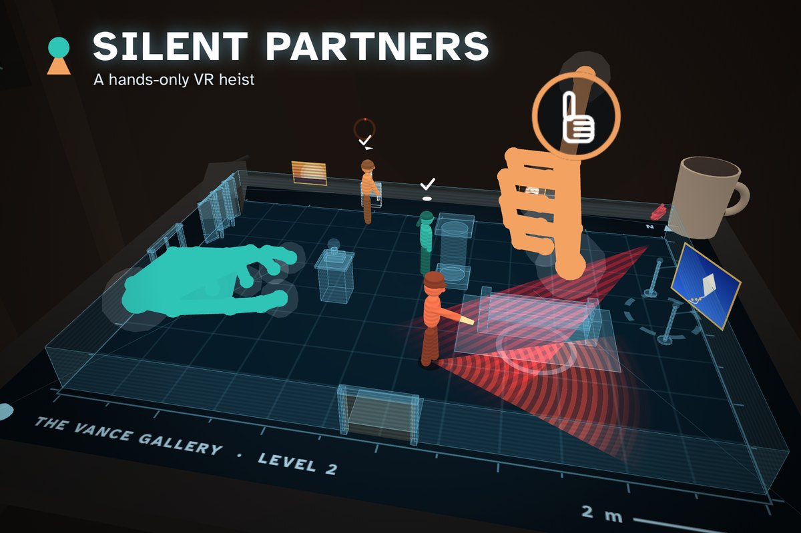

# Silent Partners



**No talking on a job.** A seated, hands-only heist for Meta Quest, built with IWSDK and WebXR. You
direct two thieves around a tabletop hologram using only hand signals. Your
left hand commands Lark (teal) and your right hand commands Rook (amber).

- **Job 1, the Vance Gallery** (about six minutes) teaches one signal at a
  time. The crew steals *The Blue Kite* without being seen by Bert, the guard,
  or the Eye, the camera.
- **Job 2, Halloran's auction house** (about ten minutes) is the real thing.
  It has seven rooms with walls that block sight and sound, and two guards
  who investigate what they hear. There are lasers to power down, lights to
  kill, a vault that takes two keys turned at once, and a motion sensor
  around *the Gilded Heron*. Every run is a different night: the guards' rounds
  and pauses change. Then both partners have to get out.

| Signal | Meaning |
| --- | --- |
| Fist | Freeze. Still and in cover means unseen. |
| Point at a spot | Go there |
| Thumbs up | Do the job here: cut the fuse, unlock the bracket, lift the painting (both thumbs), cut the power, kill the lights, turn the vault keys (both thumbs), crack the case |
| Two fingers, aimed (Job 2) | Toss a coin there. The nearest guard who hears it goes to look. Three per job. |
| Both palms up, held | Pause or resume |
| Pinch, held (one-hand mode) | Switch between Lark and Rook |

If someone is spotted, the hologram rewinds: in Job 1 to the start of the
beat, in Job 2 to the last checkpoint (taken whenever both partners are still
in cover and nobody is looking). The end card gives a
stamp: **Ghost** means no rewinds and never close to being seen, **Pro** means
two rewinds or fewer, and **Messy** covers everything else. Assist mode,
which slows the guards down (and, in Job 2, rests the vault sensor longer),
caps the stamp at Pro.

**Play:** open the GitHub Pages address for this repo in Meta Quest Browser.
For this repo that is https://radharanibasak.github.io/silent-partners/ once
Pages is on.

## What's in it

- **Hand signals as orders.** Five-number pose features from the 25 WebXR
  joints, template matching, hold windows and a command zone over the table.
- **A heist that teaches itself.** Job 1's six beats introduce one signal at a
  time. Hints escalate from a brighter icon to a ghost hand that shows the sign.
- **A second, bigger job.** Job 2 opens with a recon phase: the guards' rounds
  are drawn on the plan, and labels show the power panel, breaker, lasers, vault
  keys, sensor and the Heron. A thumbs up sends the crew in.
- **Guards with ears and a plan B.** Guards hear footsteps (freezing or creeping
  is silent; walls stop sound). In Job 2 they walk over to look at a sound, a
  coin or where they last saw someone, sweep their torch, then return to their
  rounds. Lit rooms let them see farther until the lights are cut.
- **Rewinds, not game over.** Getting seen plays the hologram back like a
  tape to the start of the beat.
- **Made entirely in code.** A hologram shader with scan-in, scanlines and an
  alarm tint. An animated crew and a surveillance van with live CCTV screens.
  An adaptive synthesised score. There are no audio files and no 3D models.
- **Accessibility.** Seated play, a one-hand mode, swappable hands, an assist
  mode, re-recordable signals, a circle and a triangle that tell the crew apart
  without colour, large high-contrast text and a music toggle.
- **Mixed reality.** On Quest 3 and 3S, tick *Mixed reality* on the landing
  page: the van gives way to your own room, and the projector sits lower,
  over your real desk. Use Table up and down to match it.

## Run it

You need Node 20.19 or later.

```sh
npm install
npm run dev        # dev server plus the IWER emulator in a managed browser
npm run check      # 45 checks: recognition, both jobs' timing and devices, bot playthroughs (about 40 s)
npm run typecheck
npm run build      # static site in dist/
```

**On a Quest during development:** run `npm run dev:runtime`, then open
`https://<your-computer's-LAN-IP>:8081` in Meta Quest Browser and accept the
certificate warning. The page asks for hand tracking. If VR doesn't start,
turn on hand tracking in the headset's settings.

**Deploy:** pushing to `main` runs `.github/workflows/pages.yml`, which
typechecks, runs the checks, builds and publishes to GitHub Pages. Turn it on
once under Settings > Pages > Source: GitHub Actions. `dist/` is a static
site with relative paths, so any HTTPS host also works (for example,
`npx vercel dist`). WebXR requires HTTPS.

## Trailer and screenshots

The trailer and the store shots are filmed from the build itself. In cinema
mode (`?cinema`), a bot plays the heist through the real input path. It
drives synthetic hands, and a headless browser captures each frame.

```sh
npx playwright install chromium   # once
npm run build
npm run film -- stills            # media/shots/*.png, 1800 x 1200; also public/cover.jpg
npm run film -- trailer           # media/trailer.mp4, 1080p30, with the score; needs ffmpeg
npm run film -- demo              # media/demo.mp4: the autoplay run from the player's eyes, captioned
npm run film -- job2              # media/job2.mp4: Job 2's autoplay night, cut to its big moments
```

Shots and cuts are listed in `scripts/film.mjs`. Rendering is CPU-bound in a
headless browser without a GPU, at roughly 3 s a frame.

### Recording a demo without a headset

Add `?autoplay` to the URL and enter VR: the same bot plays the whole heist
live, in real time. Job 1 includes one deliberate mistake and its rewind
(just over a minute). Press the Job 2 button instead to watch Halloran's
(about two and a half minutes). It works in the IWSDK emulator (`npm run dev`, then open
`https://localhost:8081/?autoplay`) and on a Quest. In the emulator, close the
two controller panels with their ⊗ buttons for a clean view, then record the
window. Say on screen that a bot is playing.

## Debugging on device

- Add `?debug` to the URL to show a panel beside the table. It lists the frame
  rate, each hand's five features, the classified pose, the filter state, aim,
  Bert's mode and the detection meters.
- With `?debug`, the last 45 s of both hands' joints are kept. After the
  session ends, use **Download hand recording** on the landing page.
- **Copy last run log** on the landing page copies the run's signals, beats,
  rewinds and result.

## Tuning

Every gameplay and recognition constant lives in `src/tuning.ts`. The values
are tuned on synthetic hands and the emulator, not yet on a real headset.
Check these first on a Quest:

- **Recognition:** `accept`, `margin` and `confirmMs`. If a relaxed hand fires
  commands, lower `accept`. If real signals are missed, raise it, or re-record
  the signals in the in-game Settings.
- **Command zone:** `zoneAbove`, `zoneMargin` and `zoneAhead` set where a hand
  counts as giving orders.
- **Tracking-edge warning:** `edgeSideDeg` and `edgeVertDeg`. Hands turn red
  near these angles.
- **Table placement:** `tableBelowEyes` and `tableDistance`. Players can also
  nudge the table in Settings.
- **Difficulty:** `bertSpeed`, `torchRange`, `eyePeriod` and the `fill*`
  times. Job 2 adds `litRange`, the `search*` and `sensor*` values, `coins` and
  the task times. If you change these, run `npm run check`. It proves that
  frozen thieves stay safe, that every checkpoint is safe to stand at, and
  that the bot can still win both jobs on several nights.

## Layout

```
src/core/      pure logic, no three.js; this is what the checks test
  recognize.ts   features, templates, classifier, confirm filter, re-recorder
  sim.ts         deterministic heist simulation (fixed 60 Hz step, snapshots)
  game.ts        beats, prompts, hints, rewinds, stamps
  bot.ts         a player that plans every move on a scratch sim
  handgen.ts     synthetic hands for the checks, the ghost hand and the trailer
src/level.ts   both jobs as data (spots, walls, guards' rounds, tasks, devices) and the route, aim and sight maths
src/tuning.ts  all constants
src/xr/        the headset layer
  system.ts      IWSDK system: hand input, panels, the game loop
  view.ts        the hologram table, light cones, hands, prompts
  holo.ts        the hologram shader (scan-in, scanlines, alarm tint)
  figure.ts      the animated crew and guard
  props.ts       both jobs' furniture and the Heron, batched into a few draw calls
  van.ts         the van: CCTV screens, signal log, rack, rain
  draw.ts        canvas text, icons, title card, artwork
  audio.ts       Web Audio sound effects
  music.ts       the adaptive score, synthesised note by note
  cinema.ts      cinema mode: bot-driven hands, frame capture, the trailer score
scripts/       film.mjs and cinema-lib.mjs: render shots and the trailer
src/store.ts   settings, best run and recorded signals (localStorage)
test/check.ts  the checks
```

## Changes from the PRD

- Bert's patrol carries on across beats instead of jumping to a set position
  at each beat.
- A rewind restores a settled snapshot. Thieves are stopped and the detection
  meters are empty, so a rewind never starts in a losing position.
- The torch range is 4.2 m, not 4.5 m, so the pillar stays dark from Bert's
  north-east pause.
- Bert grows suspicious only of thieves who are moving or working. A thief
  frozen in the open is still seen, just slowly.
- The level data is in `src/level.ts`, not a JSON file.
- Job 2, guard hearing and investigation, the coin sign and mixed reality
  were added after the PRD.

## Credits

- Atkinson Hyperlegible, by the Braille Institute, under the SIL Open Font
  License 1.1.
- IWSDK, by Meta, under the MIT license.
- three.js, under the MIT license.

There are no other third-party assets. All sound, music and art is made in
code at run time. The paintings in the gallery (*The Blue Kite* and the rest)
are original drawings made for this game.
